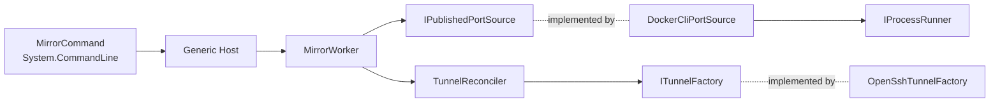

# Contributing to DockerPortMirror

Thanks for helping! Bug reports, fixes, documentation and features are all welcome. For a larger change,
open an issue first so we can agree on the approach.

## Build and test

You need the .NET 10 SDK (see `global.json`). Docker and SSH are only needed to run the tool, not to build or test it.

```shell
dotnet build
dotnet test
dotnet format --verify-no-changes   # CI fails on formatting or analyzer warnings
dotnet run --project src/DockerPortMirror -- --verbose
```

The build treats warnings as errors and runs the .NET analyzers (`Directory.Build.props`); `.editorconfig`
holds the code style. Package versions live in `Directory.Packages.props`.

## Architecture

The tool is a small core that knows nothing about processes or the console, adapters for the Docker CLI and
OpenSSH, and a thin host that wires them together.



| Folder | Contents |
| --- | --- |
| `src/DockerPortMirror/Program.cs` | Composition root: parses the command line and runs the Generic Host. |
| `Cli/` | Command-line options (`MirrorCommand`), `MirrorOptions`, their validation and configuration sources. |
| `Mirroring/` | The core: `PublishedPort`, `TunnelSpec`, the `IPublishedPortSource`/`ITunnelFactory`/`ITunnel` contracts, `PortSetDiff`, `RetryPolicy`, `TunnelReconciler` and the `MirrorWorker` polling loop. |
| `Docker/` | Resolving the Docker context (`DockerContextResolver`), parsing `docker ps` output and the `DockerCliPortSource`. |
| `Ssh/` | `SshTarget`, the `ssh` argument builder and the OpenSSH tunnel. |
| `Processes/` | Running short commands with a timeout (`ProcessRunner`) and tying child processes to the tool (Windows Job Object). |
| `Diagnostics/` | Every log message (`Log.cs`, source-generated) and the console formatter. |
| `tests/DockerPortMirror.Tests/` | xUnit tests with hand-written fakes in `Fakes/`. |

Conventions:

- User-facing failures (Docker missing, bad context, port in use) throw `DockerPortMirrorException` with a message
  that tells the user what to do. Anything else is a bug and is reported with a stack trace under `--verbose`.
- Every message goes through `Diagnostics/Log.cs`; do not write to `Console` outside `Program.cs`.
- Parsing and decisions are pure functions with tests; process and console code stays thin.

### Adding a port source

Implement `IPublishedPortSource` (or decorate the existing one, for example to filter ports) and register it in
`ServiceCollectionExtensions.AddDockerPortMirror` in place of `DockerCliPortSource`:

```csharp
internal sealed class FilteringPortSource(IPublishedPortSource inner, Func<PublishedPort, bool> include) : IPublishedPortSource
{
    public async Task<IReadOnlySet<PublishedPort>> GetPublishedPortsAsync(CancellationToken cancellationToken) =>
        (await inner.GetPublishedPortsAsync(cancellationToken)).Where(include).ToHashSet();
}
```

### Adding a transport

Implement `ITunnelFactory` and `ITunnel`: `OpenAsync` throws `TunnelStartException` when a tunnel cannot be opened
(the reconciler retries it with backoff), and `ITunnel.Completion` completes when the tunnel dies by itself.
Register the factory in place of `OpenSshTunnelFactory`.

## Pull requests

- Keep a pull request to one change, with tests for new behaviour and bug fixes.
- Update `README.md` when options or behaviour change, and add a line under **Unreleased** in `CHANGELOG.md`.
- CI builds and tests on Windows, Linux and macOS; it must be green.

## Releases (maintainers)

Versions come from git tags through [MinVer](https://github.com/adamralph/minver): push a `vX.Y.Z` tag (or
`vX.Y.Z-rc.N` for a pre-release) and the **Release** workflow publishes the binaries, checksums, the .NET tool
(with the `NUGET_API_KEY` secret) and the winget update (with the `WINGET_TOKEN` secret). See
[packaging/winget/README.md](packaging/winget/README.md) for the first winget submission.
