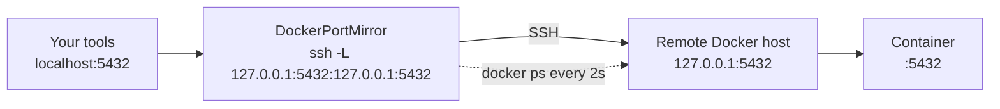
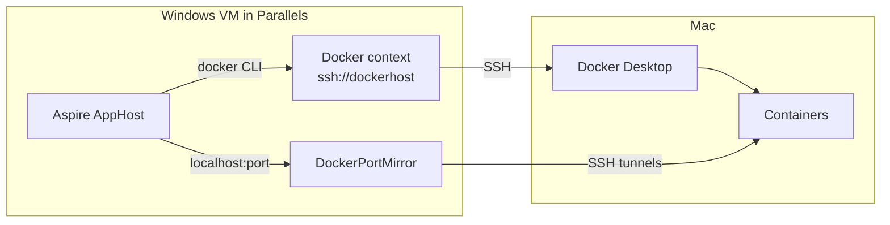

# DockerPortMirror

[](https://github.com/william-liebenberg/DockerPortMirror/actions/workflows/ci.yml)
[](LICENSE)

Use a remote Docker host as if it were local: DockerPortMirror makes every TCP port published by its containers
reachable on your machine's `localhost`, and keeps the list up to date as containers start and stop.

It runs on Windows, Linux and macOS, against any Docker host you reach through an
[SSH Docker context](https://docs.docker.com/engine/security/protect-access/#use-ssh-to-protect-the-docker-daemon-socket)
(`ssh://user@host`).

## Why this tool exists

DockerPortMirror was written for one setup: a Mac running Docker Desktop, and a Windows VM under Parallels on that
same Mac for .NET work. Running Docker inside the VM as well is heavy (nested virtualization, a second Docker VM, a
second copy of every image) and not always possible on Apple silicon. Using the Mac's Docker from Windows is
simpler: install only the Docker CLI on Windows, and point it at Docker Desktop on the Mac through an SSH Docker
context.

That works for `docker` commands, but not quite for [.NET Aspire](https://aspire.dev). Aspire starts the
containers of an application (databases, caches, message brokers…) through the Docker CLI, which follows the
context, so they run on the Mac. Aspire then connects to them on `localhost`, which is the Windows VM, where nothing
listens: the ports were published on the Mac. Connections fail, resources do not become healthy, and the links of
the Aspire dashboard lead nowhere.

DockerPortMirror closes that gap: every port the Mac publishes shows up on the VM's `localhost`, as containers come
and go, so Aspire, your browser and your database tools work as if Docker ran on Windows. The
[step-by-step guide](#step-by-step-net-aspire-in-a-windows-vm-docker-desktop-on-the-mac) below sets this up from
scratch. The tool itself does not depend on Parallels or Aspire: it works with any Docker host you reach over SSH.

## The problem it solves

With an SSH Docker context, `docker run -p 5432:5432 postgres` publishes port 5432 on the **remote** host, not on
your machine. Reaching it means opening an SSH tunnel by hand for every port, and again whenever containers
change. DockerPortMirror watches the remote containers and opens one OpenSSH local forward per published port:



This also works when Docker publishes ports on the remote host's loopback only (`-p 127.0.0.1:5432:5432`),
which no LAN-level port forwarding can reach.

## Install

| Method | Command |
| --- | --- |
| .NET tool (any OS, needs the .NET 10 runtime) | `dotnet tool install -g DockerPortMirror` |
| winget (Windows) | `winget install WilliamLiebenberg.DockerPortMirror` |
| Binary (any OS, no runtime needed) | Download the archive for your platform from [Releases](https://github.com/william-liebenberg/DockerPortMirror/releases), check it against `SHA256SUMS.txt`, and put `DockerPortMirror` on your `PATH`. |

The .NET tool and winget install the command as `dockerportmirror`.

### Prerequisites

- The Docker CLI (`docker`) on `PATH`, with an SSH Docker context that works (`docker --context <name> ps`).
- The OpenSSH client (`ssh`) on `PATH`: built into Windows 10+ (optional feature "OpenSSH Client"), Linux and macOS.
- Non-interactive SSH authentication: a key without passphrase, or a key loaded in `ssh-agent`.
  DockerPortMirror runs SSH with `BatchMode=yes`, so it never stops to ask for a password.

## Quick start

```shell
docker context create remote --docker "host=ssh://me@dockerhost"
docker context use remote
dockerportmirror
```

In a terminal it shows a live dashboard: the connection, every mirrored port with its container and status, and
the latest messages.

```text
╭─DockerPortMirror 1.2.0───────────────────────────────────────────────────────────────────╮
│ Context  remote (ssh://me@dockerhost)    SSH  me@dockerhost                              │
│ Bind  127.0.0.1    Poll  2s    Docker  ● reachable    Ctrl+C to stop                     │
╰──────────────────────────────────────────────────────────────────────────────────────────╯
╭─Mirrored ports (4)───────────────────────────────────────────────────────────────────────╮
│ Container  Local           Remote          Status                                        │
│ api        localhost:3000  127.0.0.1:3000  ✗ retry in 4s: bind [127.0.0.1]:3000: Addres… │
│ postgres   localhost:5432  127.0.0.1:5432  ● open                                        │
│ web        localhost:8080  127.0.0.1:8080  ● open                                        │
│            localhost:8443  127.0.0.1:8443  ● open                                        │
╰──────────────────────────────────────────────────────────────────────────────────────────╯
╭─Log──────────────────────────────────────────────────────────────────────────────────────╮
│ 10:41:02  + localhost:5432 -> me@dockerhost -> 127.0.0.1:5432 (postgres)                 │
│ 10:41:02  + localhost:8080 -> me@dockerhost -> 127.0.0.1:8080 (web)                      │
│ 10:41:02  + localhost:8443 -> me@dockerhost -> 127.0.0.1:8443 (web)                      │
│ 10:41:03  ! localhost:3000 (api) failed: bind [127.0.0.1]:3000: Address already in use … │
╰──────────────────────────────────────────────────────────────────────────────────────────╯
```

Ports are grouped by container. A port that could not be mirrored is retried with a growing delay
(1s, 2s, 4s … 60s), and its status counts down to the next attempt. When `docker ps` fails, the Docker status turns
red and the open tunnels stay as they are. Press Ctrl+C to stop: every tunnel is closed and the last frame stays on
screen.

When the output is redirected, or with `--no-dashboard`, it prints one line per event instead:

```text
DockerPortMirror 1.2.0
Docker context : remote  (ssh://me@dockerhost)
SSH target     : me@dockerhost
Local bind     : 127.0.0.1   Poll: 2s
Press Ctrl+C to stop.
 + localhost:5432 -> me@dockerhost -> 127.0.0.1:5432 (postgres)
 + localhost:8080 -> me@dockerhost -> 127.0.0.1:8080 (web)
 - localhost:8080 (web)
 ! localhost:3000 (api) failed: bind [127.0.0.1]:3000: Address already in use (retry in 1s)
```

`+` is a new tunnel, `-` a tunnel removed because its container stopped, and `!` a port that could not be mirrored;
it is reported again only if the reason changes.

> [!NOTE]
> The console output is meant for people and may change between versions; do not parse it in scripts.

## Step-by-step: .NET Aspire in a Windows VM, Docker Desktop on the Mac

This guide sets up the whole chain, from Docker Desktop on the Mac to Aspire on Windows:



The examples use `you` for your Mac user name, `dockerhost` for the SSH alias of the Mac, and `mac-docker` for the
Docker context; pick your own names if you prefer. Commands for Windows are PowerShell.

### 1. Docker Desktop on the Mac

1. Install [Docker Desktop for Mac](https://docs.docker.com/desktop/setup/install/mac-install/) and start it.
2. In Docker Desktop, open **Settings > Advanced**:
   - Set the installation of Docker's CLI tools to **System**, so that `docker` is in `/usr/local/bin`. SSH
     commands run without your shell profile, and Docker over SSH needs `docker` on that default `PATH`.
   - Turn on **Allow the default Docker socket to be used**.
3. In **Settings > General**, turn on **Start Docker Desktop when you sign in to your computer**, so Docker is there
   whenever the VM needs it.
4. Check it in a Mac terminal: `docker run --rm hello-world`.

### 2. Remote Login (SSH) on the Mac

1. Open **System Settings > General > Sharing** and turn on **Remote Login**. Under its **(i)** button, allow access
   to your user.
2. Note your user name: `whoami` in a Mac terminal.

### 3. The address of the Mac, seen from the VM

With Parallels' default **Shared Network**, the VM is on a private network with the Mac, which is usually
`10.211.55.2` (the VM gets another `10.211.55.x` address, and `10.211.55.1` is the gateway). To check:

- On Windows, `ipconfig` shows the VM's address and its subnet.
- On the Mac, `ifconfig | grep "inet 10.211.55"` shows the Mac's address in that subnet.

From Windows, `Test-NetConnection 10.211.55.2 -Port 22` must report `TcpTestSucceeded : True`.

> [!TIP]
> Use this private address rather than the Mac's Wi-Fi address: it does not change when the Mac changes network.

### 4. Passwordless SSH from Windows to the Mac

1. Check that the OpenSSH client is installed on Windows (it is by default on Windows 10 1809+ and Windows 11):
   `ssh -V`. If not, add the optional feature **OpenSSH Client** in **Settings > System > Optional features**.
2. Create a key pair, if you do not have one. Press Enter at the passphrase prompt for a key without a passphrase
   (see the note below for a key with one):

   ```powershell
   ssh-keygen -t ed25519
   ```

3. Copy the public key to the Mac; this asks for your Mac password one last time:

   ```powershell
   Get-Content $env:USERPROFILE\.ssh\id_ed25519.pub |
     ssh you@10.211.55.2 "mkdir -p ~/.ssh && chmod 700 ~/.ssh && cat >> ~/.ssh/authorized_keys && chmod 600 ~/.ssh/authorized_keys"
   ```

4. Give the Mac a name: add this to `%USERPROFILE%\.ssh\config` (create the file if needed):

   ```text
   Host dockerhost
     HostName 10.211.55.2
     User you
     IdentityFile ~/.ssh/id_ed25519
   ```

   An entry `10.211.55.2 dockerhost` in `C:\Windows\System32\drivers\etc\hosts` works too, but needs
   administrator rights.
5. Connect once interactively, and answer `yes` to trust the Mac's host key: `ssh dockerhost`, then `exit`.
6. Check that SSH needs no prompt, and finds `docker` on the Mac:

   ```powershell
   ssh -o BatchMode=yes dockerhost docker version
   ```

   It must print the client and server versions, without asking anything.

> [!NOTE]
> For a key with a passphrase, load it into the Windows `ssh-agent` once, from an administrator PowerShell:
> `Get-Service ssh-agent | Set-Service -StartupType Automatic; Start-Service ssh-agent`, then `ssh-add` as yourself.
> DockerPortMirror runs SSH with `BatchMode=yes`, so it can only use keys that need no prompt.

### 5. The Docker CLI on Windows

Install only the CLI, not Docker Desktop:

```powershell
winget install Docker.DockerCLI
```

Optionally, `winget install Docker.Buildx` too, so that `docker build` (and Aspire's `AddDockerfile`) uses BuildKit.
Open a new terminal afterwards, so `docker` is on `PATH`.

### 6. The Docker context on Windows

Create a context that reaches Docker on the Mac through SSH, and make it the current one:

```powershell
docker context create mac-docker --docker "host=ssh://dockerhost"
docker context use mac-docker
```

`docker context use` is saved in `%USERPROFILE%\.docker\config.json`, so every program that runs `docker`, Aspire
included, now uses the Mac. Check it:

```powershell
docker context ls          # mac-docker is marked with *
docker ps                  # lists the containers on the Mac
docker run --rm hello-world
```

At this point Docker works from Windows, but a published port is still only on the Mac:
`docker run -d -p 8080:80 nginx` answers on the Mac's `localhost:8080`, not on Windows' `localhost:8080`.

### 7. DockerPortMirror

Install it (or see [Install](#install) for the other ways):

```powershell
winget install WilliamLiebenberg.DockerPortMirror
```

Run it in a terminal of its own, and leave it running while you work:

```powershell
dockerportmirror
```

It mirrors the current context, `mac-docker`, through `dockerhost`. With the nginx container of the previous step
still running, `http://localhost:8080` now opens in a browser on Windows (`docker rm -f` the container afterwards).

### 8. .NET Aspire

Run your Aspire application as usual, with `aspire run` or `dotnet run --project <YourApp.AppHost>`. Aspire starts
its containers on the Mac, DockerPortMirror mirrors their ports to Windows within one poll interval (2 seconds by
default), and Aspire, its dashboard and your tools reach them on `localhost`.

Things to know with this setup:

- Start DockerPortMirror before the AppHost, or at least keep it running: Aspire retries its connections, so a port
  mirrored a moment after its container started is fine.
- Bind mounts are resolved on the Mac: a Windows path such as `C:\src\app\data` in `WithBindMount` does not exist
  there. Prefer volumes (`WithDataVolume`).
- Containers that call back to projects running on Windows through `host.docker.internal` reach the Mac, not the
  VM: DockerPortMirror forwards only from Windows to the containers.
- Docker Desktop must be running on the Mac; when it is not, the dashboard of DockerPortMirror shows Docker in red
  until it comes back.

## Options

```text
Usage:
  DockerPortMirror [options]

Options:
  --context <name>       Docker context to mirror. Default: the current context (docker context show).
  --ssh-target <target>  SSH host alias, user@host or ssh://user@host:port. Default: derived from the context's ssh:// endpoint.
  --bind <address>       Local bind address. Default: 127.0.0.1.
  --poll <seconds>       Docker polling interval in seconds. Default: 2.
  -v, --verbose          Show SSH and Docker diagnostics, and stack traces of unexpected errors.
  --no-dashboard         Print one line per event instead of the live dashboard. Automatic when output is redirected.
  --config <path>        Configuration file (JSON). Default: config.json in the user configuration folder, when it exists.
  -?, -h, --help         Show help and usage information
  --version              Show version information
```

- `--bind` accepts only `127.0.0.1` or `localhost`, so mirrored ports are never exposed to your network.
- `--poll` accepts 1 to 3600 seconds. Each poll runs one `docker ps`, which opens one SSH connection.
- `--ssh-target` is useful when the context uses a different name than your `~/.ssh/config` alias, or when the
  endpoint is not `ssh://` but the host is reachable through SSH.

## Configuration

Options can also come from a JSON file and from environment variables. Command-line options win over
environment variables, which win over the file.

| Setting | JSON key | Environment variable |
| --- | --- | --- |
| Docker context | `Context` | `DOCKERPORTMIRROR_CONTEXT` |
| SSH target | `SshTarget` | `DOCKERPORTMIRROR_SSHTARGET` |
| Bind address | `BindAddress` | `DOCKERPORTMIRROR_BINDADDRESS` |
| Poll interval (seconds) | `PollSeconds` | `DOCKERPORTMIRROR_POLLSECONDS` |
| Verbose output | `Verbose` | `DOCKERPORTMIRROR_VERBOSE` |
| Plain output instead of the dashboard | `NoDashboard` | `DOCKERPORTMIRROR_NODASHBOARD` |

The file is `--config <path>`, or else, when it exists, `config.json` in the user configuration folder:
`%APPDATA%\DockerPortMirror\config.json` on Windows, `~/.config/DockerPortMirror/config.json` on Linux and macOS.

```json
{
  "Context": "remote",
  "PollSeconds": 5
}
```

## How it works

- Every poll runs `docker --context <context> ps --format "{{.Names}}\t{{.Ports}}"` and reads the published TCP
  ports and their container, including port ranges and IPv4/IPv6 bindings.
- For each port it starts `ssh -N -L <bind>:<port>:<address>:<port> <target>`, where `<address>` is `127.0.0.1`
  when Docker publishes on all interfaces, or the specific address the container is published on.
- Tunnels are closed when their port disappears, and restarted when SSH exits.
- When the tool stops, every `ssh` process is stopped. On Windows the `ssh` processes are also tied to the tool
  with a Job Object, so they stop even if the tool is killed or its console window is closed.

## Troubleshooting

| Symptom | Check |
| --- | --- |
| `The Docker endpoint of context '…' is not SSH-based` | `docker context ls`: select an `ssh://` context, or pass `--ssh-target`. |
| `OpenSSH could not resolve SSH target` | `ssh -G <target>` must succeed; check `~/.ssh/config`. |
| Tunnels fail with `Permission denied (publickey)` | `ssh -o BatchMode=yes <target> true` must succeed without a prompt; load your key with `ssh-add`. |
| `Unable to query Docker context` | `docker --context <name> ps` must work on its own. |
| `! localhost:<port> failed: … Address already in use` (`Permission denied` on Windows) | Another program uses the port locally. Find it with `Get-NetTCPConnection -LocalPort <port> -State Listen` (Windows) or `lsof -iTCP:<port> -sTCP:LISTEN` (Linux, macOS). |
| Anything else | Run with `--verbose` to see every `docker` and `ssh` command and SSH's own diagnostics. |

## Limitations

- TCP only: UDP ports are not mirrored.
- The local port is always the published port; two remote containers cannot be mirrored to the same local port.
- Ports below 1024 may need elevated rights on Linux and macOS.
- Changes are seen by polling, so a new port appears after up to one poll interval.

## Build from source

```shell
dotnet build
dotnet test
dotnet run --project src/DockerPortMirror -- --help
```

See [CONTRIBUTING.md](CONTRIBUTING.md) for the architecture and how to contribute.

## License

[MIT](LICENSE)
