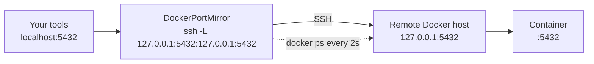

# DockerPortMirror

[](https://github.com/william-liebenberg/DockerPortMirror/actions/workflows/ci.yml)
[](LICENSE)

Use a remote Docker host as if it were local: DockerPortMirror makes every TCP port published by its containers
reachable on your machine's `localhost`, and keeps the list up to date as containers start and stop.

It runs on Windows, Linux and macOS, against any Docker host you reach through an
[SSH Docker context](https://docs.docker.com/engine/security/protect-access/#use-ssh-to-protect-the-docker-daemon-socket)
(`ssh://user@host`).

## The problem it solves

With an SSH Docker context, `docker run -p 5432:5432 postgres` publishes port 5432 on the **remote** host, not on
your machine. Reaching it means opening an SSH tunnel by hand for every port, and again whenever containers
change. DockerPortMirror watches the remote containers and opens one OpenSSH local forward per published port:



This also works when Docker publishes ports on the remote host's loopback only (`-p 127.0.0.1:5432:5432`),
which no LAN-level port forwarding can reach.

## Install

| Method | Command |
| --- | --- |
| .NET tool (any OS, needs the .NET 10 runtime) | `dotnet tool install -g DockerPortMirror` |
| winget (Windows) | `winget install WilliamLiebenberg.DockerPortMirror` |
| Binary (any OS, no runtime needed) | Download the archive for your platform from [Releases](https://github.com/william-liebenberg/DockerPortMirror/releases), check it against `SHA256SUMS.txt`, and put `DockerPortMirror` on your `PATH`. |

The .NET tool and winget install the command as `dockerportmirror`.

### Prerequisites

- The Docker CLI (`docker`) on `PATH`, with an SSH Docker context that works (`docker --context <name> ps`).
- The OpenSSH client (`ssh`) on `PATH`: built into Windows 10+ (optional feature "OpenSSH Client"), Linux and macOS.
- Non-interactive SSH authentication: a key without passphrase, or a key loaded in `ssh-agent`.
  DockerPortMirror runs SSH with `BatchMode=yes`, so it never stops to ask for a password.

## Quick start

```shell
docker context create remote --docker "host=ssh://me@dockerhost"
docker context use remote
dockerportmirror
```

```text
DockerPortMirror 1.2.0
Docker context : remote  (ssh://me@dockerhost)
SSH target     : me@dockerhost
Local bind     : 127.0.0.1   Poll: 2s
Press Ctrl+C to stop.
 + localhost:5432 -> me@dockerhost -> 127.0.0.1:5432
 + localhost:8080 -> me@dockerhost -> 127.0.0.1:8080
 - localhost:8080
 ! localhost:3000 failed: bind [127.0.0.1]:3000: Address already in use (retry in 1s)
```

`+` is a new tunnel, `-` a tunnel removed because its container stopped, and `!` a port that could not be mirrored;
it is retried with a growing delay (1s, 2s, 4s … 60s) and reported again only if the reason changes.
Press Ctrl+C to stop: every tunnel is closed.

> [!NOTE]
> The console output is meant for people and may change between versions; do not parse it in scripts.

## Options

```text
Usage:
  DockerPortMirror [options]

Options:
  --context <name>       Docker context to mirror. Default: the current context (docker context show).
  --ssh-target <target>  SSH host alias, user@host or ssh://user@host:port. Default: derived from the context's ssh:// endpoint.
  --bind <address>       Local bind address. Default: 127.0.0.1.
  --poll <seconds>       Docker polling interval in seconds. Default: 2.
  -v, --verbose          Show SSH and Docker diagnostics, and stack traces of unexpected errors.
  --config <path>        Configuration file (JSON). Default: config.json in the user configuration folder, when it exists.
  -?, -h, --help         Show help and usage information
  --version              Show version information
```

- `--bind` accepts only `127.0.0.1` or `localhost`, so mirrored ports are never exposed to your network.
- `--poll` accepts 1 to 3600 seconds. Each poll runs one `docker ps`, which opens one SSH connection.
- `--ssh-target` is useful when the context uses a different name than your `~/.ssh/config` alias, or when the
  endpoint is not `ssh://` but the host is reachable through SSH.

## Configuration

Options can also come from a JSON file and from environment variables. Command-line options win over
environment variables, which win over the file.

| Setting | JSON key | Environment variable |
| --- | --- | --- |
| Docker context | `Context` | `DOCKERPORTMIRROR_CONTEXT` |
| SSH target | `SshTarget` | `DOCKERPORTMIRROR_SSHTARGET` |
| Bind address | `BindAddress` | `DOCKERPORTMIRROR_BINDADDRESS` |
| Poll interval (seconds) | `PollSeconds` | `DOCKERPORTMIRROR_POLLSECONDS` |
| Verbose output | `Verbose` | `DOCKERPORTMIRROR_VERBOSE` |

The file is `--config <path>`, or else, when it exists, `config.json` in the user configuration folder:
`%APPDATA%\DockerPortMirror\config.json` on Windows, `~/.config/DockerPortMirror/config.json` on Linux and macOS.

```json
{
  "Context": "remote",
  "PollSeconds": 5
}
```

## How it works

- Every poll runs `docker --context <context> ps --format {{.Ports}}` and reads the published TCP ports,
  including port ranges and IPv4/IPv6 bindings.
- For each port it starts `ssh -N -L <bind>:<port>:<address>:<port> <target>`, where `<address>` is `127.0.0.1`
  when Docker publishes on all interfaces, or the specific address the container is published on.
- Tunnels are closed when their port disappears, and restarted when SSH exits.
- When the tool stops, every `ssh` process is stopped. On Windows the `ssh` processes are also tied to the tool
  with a Job Object, so they stop even if the tool is killed or its console window is closed.

## Troubleshooting

| Symptom | Check |
| --- | --- |
| `The Docker endpoint of context '…' is not SSH-based` | `docker context ls`: select an `ssh://` context, or pass `--ssh-target`. |
| `OpenSSH could not resolve SSH target` | `ssh -G <target>` must succeed; check `~/.ssh/config`. |
| Tunnels fail with `Permission denied (publickey)` | `ssh -o BatchMode=yes <target> true` must succeed without a prompt; load your key with `ssh-add`. |
| `Unable to query Docker context` | `docker --context <name> ps` must work on its own. |
| `! localhost:<port> failed: … Address already in use` (`Permission denied` on Windows) | Another program uses the port locally. Find it with `Get-NetTCPConnection -LocalPort <port> -State Listen` (Windows) or `lsof -iTCP:<port> -sTCP:LISTEN` (Linux, macOS). |
| Anything else | Run with `--verbose` to see every `docker` and `ssh` command and SSH's own diagnostics. |

## Limitations

- TCP only: UDP ports are not mirrored.
- The local port is always the published port; two remote containers cannot be mirrored to the same local port.
- Ports below 1024 may need elevated rights on Linux and macOS.
- Changes are seen by polling, so a new port appears after up to one poll interval.

## Build from source

```shell
dotnet build
dotnet test
dotnet run --project src/DockerPortMirror -- --help
```

See [CONTRIBUTING.md](CONTRIBUTING.md) for the architecture and how to contribute.

## License

[MIT](LICENSE)
